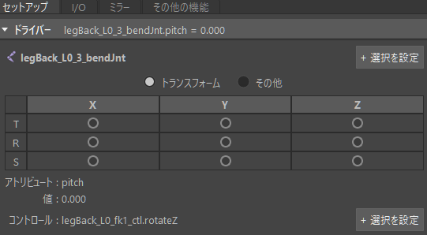
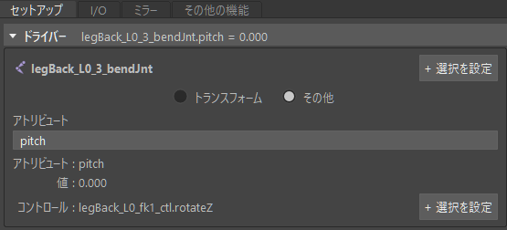
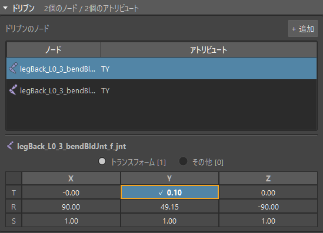
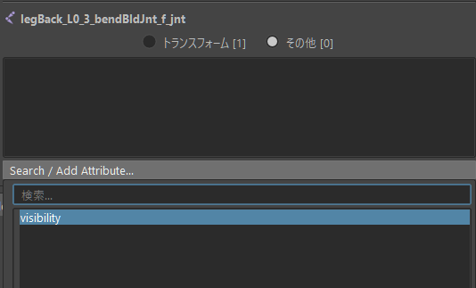
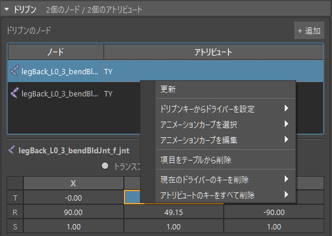
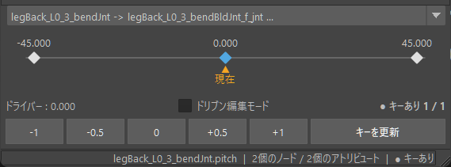
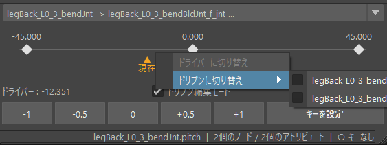

<p align="center">
  
</p>

# SDKK

[English](README.md)

Maya用のSet Driven Keyツールです。
タイムラインやビューポートでポーズを付け、ボタン1つでキーを打てます。
ドリブンキーの管理、ミラー、エクスポート、インポートができます。

## 概要

SDKKは、ドリブンキー(SDK)の作成と管理を1つのウィンドウで行います。

- セットアップ: ドライバーを選び、ドリブンのノードを追加して、現在のポーズを現在のドライバー値でキーにします。ポーズストリップスライダーに、キーが打たれたドライバー値がすべて並びます。ポーズストリップスライダー上で、キーのスクラブ、移動、削除ができます。
- I/O: 選択したノード(またはシーン全体)のドリブンキーをJSONファイルへエクスポートし、インポートで戻します。名前の違うキャラクターへも読み込めます。
- ミラー: 名前のルール(たとえば`_L`から`_R`)に従って、ドリブンキーを反対側へコピーします。ドライバー軸の反転と値の反転は、キーごとに指定できます。
- その他の機能: タイムライン上のアニメーションをドリブンキーへ変換します。

また、UIはの言語は英語と日本語の切り替えが可能です。（Options > Language）

GUIの操作は、同じ内容のPythonコマンドとしてScript Editorに出力されます。

## 動作環境

| 項目 | 内容 |
| --- | --- |
| Maya | 2023以降(Python 3.9以上) |
| Qt.py | `vendor/`に同梱しています(2.0.7)。インストールは不要です。 |

## インストール

1. このリポジトリを、`sdkk`という名前のフォルダとして、Mayaのscriptsディレクトリへコピーします。

   - Windows: `%USERPROFILE%\Documents\maya\scripts\sdkk`
   - macOS: `~/Library/Preferences/Autodesk/maya/scripts/sdkk`
   - Linux: `~/maya/scripts/sdkk`

2. Mayaを再起動します。

別の場所に置く場合は、そのフォルダの親ディレクトリをPythonのパスへ追加します。

```python
import sys
sys.path.insert(0, r"/path/to/parent_of_sdkk")
```

## 使い方

Script EditorのPythonタブから、ウィンドウを開きます。

```python
import sdkk
sdkk.show()
```

### セットアップ

「セットアップ」タブで、ドリブンキーを作ります。

以下が全体の大まかな手順です。

1. ドライバーを設定します。Mayaでドライバーのノードを選び、「+ 選択を設定」を押します。続けて、ドライバーのアトリビュートを選びます。
2. ドリブンのノードを追加します。Mayaでノードを選び、「+ 追加」を押します。
3. ドリブンのアトリビュートを選びます。選択したノードのトランスフォームのセル(TXからSZ)を切り替えます。それ以外は「その他」から選びます。
4. ドライバーを動かして、ドリブンのポーズを付けます。ポーズストリップスライダーをドラッグするか、プリセットのボタンを使います。
5. キーのボタンを押します。選択した行(行を選んでいないときは、表示中のノード)の、有効なドリブンのアトリビュートすべてに、現在のドライバー値でキーを打ちます。

「ドリブン編集モード」をオンにすると、ポーズストリップスライダーやプリセットでドライバーを動かしている間、ドリブンのノードは今のポーズのままになります。

#### ドライバー

トランスフォームのXYZか、その他のアトリビュートのどちらをドライバーにするかで設定方法が変わります。

「トランスフォーム」では、トランスフォームの9個のアトリビュート(TXからSZ)から選びます。



「その他」では、検索できる一覧から、ノードのそれ以外のアトリビュートを選びます。



- 「コントロール」: ドライバーに入力接続があって直接動かせないとき(たとえば、コントローラーが動かしているとき)に、代わりに動かすアトリビュートです。コントローラーのアトリビュートをチャンネルボックスで選び、「コントロール」の横の「+ 選択を設定」を押します(行の右クリックメニューの「チャンネルボックスから設定」でも設定できます)。ポーズストリップスライダーとプリセットは、コントロールを同じ量だけ動かし、キーは、その結果のドライバー値で打たれます。右クリックメニューの「クリア」で外せます。ドライバーのアトリビュートを変えると、外れます。

#### ドリブン



- 行をクリックすると、そのノードのアトリビュートをテーブルの下で編集できます。複数の行を選ぶと、まとめてキーを打てます。
- テーブルの下のノード名をクリックすると、Mayaでそのノードを選択します。
- 「トランスフォーム」: セルをクリックすると、そのアトリビュートが有効になります。
- 「その他」: 検索できる一覧から選んで、トランスフォーム以外のアトリビュートを追加します。



行を右クリックすると、次のメニューが出ます。
トランスフォームのセルと「その他」の項目のメニューには、そのアトリビュートに使える項目だけが並びます。



- 「更新」: シーンを読み直して、ウィンドウを描き直します。
- 「ドリブンキーからドライバーを設定」: 選んでいるノードをすでに動かしているアトリビュートが並びます。選ぶと、それをドライバーに設定します。
- 「アニメーションカーブを選択」: animCurve(とblendWeighted)のノードを、Mayaで選択します。
- 「アニメーションカーブを編集」: animCurveを選択してGraph Editorを開き、キーを編集できるようにカーブ全体を表示します。
- 「項目をテーブルから削除」: ノードまたはアトリビュートを、セットアップから外します。シーンは変更しません。ノードの行と、「その他」のリストの項目で使えます。
- 「現在のドライバーのキーを削除」: そのアトリビュートのうち、現在のドライバーのキーを削除します。
- 「アトリビュートのキーをすべて削除」: そのアトリビュートのドリブンキーを、すべてのドライバー分まとめて削除します。先に確認ダイアログが出ます。

#### ポーズストリップスライダー



- 一番上のドロップダウン: これまでに使ったドライバーとドリブンの組(履歴)から、セットアップタブの組を切り替えます。
- プリセットのボタン: クリックすると、ボタンの数字をドライバーに加えます(`0`のボタンは、ドライバーを0にします)。中クリックすると、数字を書き換えられます。書き換えた数字は保存されます。

| 操作 | 結果 |
| --- | --- |
| 左ドラッグ | ドライバーをスクラブします。「スライダーをキーに吸着」がオンのときは、近くのキーに吸い付きます。Shiftを押すと0.1刻みになります。 |
| キーを中ドラッグ | 両隣のキーの間で、そのキーを動かします。最初と最後のキーは、外側へもドラッグできます。Shiftを押すと0.1刻みになります。 |
| キーを右クリック | 「キーを削除」で、そのドライバー値のキーを削除します。 |

塗りつぶしの菱形は、すべてのアトリビュートにキーがあることを示します。
点のある中抜きの菱形は、一部のアトリビュートだけにキーがあることを示します。
三角形は、現在のドライバー値です。

「スライダーをキーに吸着」は、「オプション > 設定...」で切り替えます。

##### ドリブンのアトリビュートに切り替える

ポーズストリップスライダーを右クリックすると、操作する対象をドリブンのアトリビュートへ切り替えられます。



- 「ドリブンに切り替え」: 有効なドリブンのアトリビュートが、「ノード名.アトリビュート名」で並びます。選ぶと、ポーズストリップスライダーには、そのアトリビュートのキーが並びます。ドラッグとプリセットのボタンは、そのアトリビュートを直接動かします。「ドリブン編集モード」がオンのときに限り、選べます。
- 「ドライバーに切り替え」: 操作する対象を、ドライバーに戻します。

次のときは、自動的にドライバーへ戻ります。

- 「ドリブン編集モード」をオフにしたとき
- ドライバーを別のものに変えたとき
- 選んでいたアトリビュートが、有効なアトリビュートから外れたとき

ドリブンに切り替えている間は、キーの右クリックメニューに「キーを削除」が出ません。

#### 履歴

「履歴」メニューで、これまでに使ったドライバーとドリブンの組を、セットアップタブへ復元します。
存在しなくなったノードは、ステータスバーに表示されます。
履歴に残す組の数は、「オプション > 設定...」の「最大件数」で変えます。

### I/O

「I/O」タブで、ドリブンキーをJSONとしてエクスポートとインポートします。
「ツール > ドリブンキーをエクスポート...」と「ツール > ドリブンキーをインポート...」は、同じ内容を別ウィンドウで開きます。

エクスポート

1. 「探す基準」で「ドライバー」か「ドリブン」を選び、読み込むノードがどちら側かを指定します。
2. 「選択から読み込む」(選択したノードのうち、ドリブンキーがあるもの)か、「シーンから読み込む」(ドリブンキーがあるすべてのノード)を押します。
3. エクスポートするノードにチェックを入れて、「エクスポート...」を押します。そのノードが動かしている(または動かされている)ドリブンキーが、ファイルに書き出されます。

インポート

1. 「ファイルを開く...」を押して、JSONファイルを選びます。ファイル内のドリブンキーが一覧になり、適用できるものにチェックが入ります。
2. 「すでにある場合」を設定します。「置換」は、シーンにすでにあるドリブンキーを作り直します。「スキップ」は、そのまま残します。
3. 「インポート」を押します。

ロックされたアトリビュートへは、「オプション > 設定...」の「適用時にロックされたドリブンを解除」がオンのときに限り、適用できます。
適用中だけ解除し、適用後にまたロックします。

適用できない項目の理由は、「状態」列とそのツールチップに出ます。
たとえば、ノードが存在しない、アトリビュートがロックされている、アトリビュートにほかの入力がある、などです。
インポート中は、シーンの単位をファイルの単位へ切り替え、終わったら元に戻します。

### ミラー

「ミラー」タブは、名前のルールに従って、ドリブンキーを反対側へコピーします。

1. 「ルール」でルールを設定します。
   - 「検索」と「置換」: ノード名の中で置き換える文字列と、置き換え先です。名前に「検索」の文字列を含むドリブンキーだけが一覧になります。矢印のボタンで、2つの欄を入れ替えます。
   - 「正規表現」: 「検索」を正規表現、「置換」をその置換文字列として使います。
   - 「値を反転」: 値の符号を反転するドリブンのアトリビュートの既定値です(たとえば`TX`)。
   - 「ドライバーを反転」: 入力の軸を反転するドライバーのアトリビュートの既定値です。
   - 「すでにある場合」: ミラー先にドリブンキーがすでにあるときの扱いです。「置換」は作り直し、「スキップ」は残します。
2. 「対象」で、「探す基準」の「ドライバー」か「ドリブン」を選び、「選択から読み込む」か「シーンから読み込む」を押します。
3. テーブルを確認します。「ドライバー反転」と「値の反転」は行ごとに変えられ、変えた指定はそのドリブンキーに残ります。
4. ミラーする行にチェックを入れて、「ミラー」を押します。状態が「未ミラー」と「差異あり」の行には、最初からチェックが入ります。


以下は、ミラーテーブルでのミラーができるかどうかをあらわす状態の表になります。

ミラー前やミラー後にエラーがないかチェックすることができます。

| 状態 | 意味 |
| --- | --- |
| OK | ミラー先がすでに一致しています。 |
| 未ミラー | ミラー先のノードはありますが、ドリブンキーがありません。 |
| 差異あり | ミラー先のドリブンキーが、ミラー結果と違います。ツールチップに最初の差分が出ます。 |
| 見つからない | ミラー先のドライバーまたはドリブンのノードが存在しません。 |
| 確認不可 | ミラー先の状態を確認できない場合(あいまいな名前、型の不一致、読み取れないカーブなど)。 |
| ミラー不可 | ルールを適用できない場合(たとえば、step系の接線を持つカーブのドライバー軸を反転しようとした場合)。 |

### その他の機能

「その他の機能」タブは、現在のところタイムライン上のアニメーションをドリブンキーへ変換する機能があります。

1. 「セットアップ」で、ドライバーを設定し、ドリブンのノードを追加します。
2. ドライバーを目的の値まで動かしながら、ドリブンのノードをタイムライン上でアニメーションさせます。
3. 「その他の機能」で「アニメーションを読み込む」を押します。ドリブンのノードのアニメーション付きアトリビュートが、キーの数とドライバーの範囲とともに一覧になります。
4. 変換するアトリビュートにチェックを入れて、「ドリブンキーへ変換」を押します。変換したアトリビュートのタイムラインのアニメーションは、削除されます。

ドライバーは、キーをまたいで増加し続けるか、減少し続ける必要があります。
同じドライバー値へ戻る動きはドリブンキーにできず、その行はエラーとして表示されます。

### ツールメニュー

「ツール」メニューには、エクスポートとインポートのほか、次の項目があります。

- 「ドリブンキービューア...」: シーンのドリブンキーを一覧にします。行を右クリックすると、「ドライバーに設定」と「ドリブンに追加」で、その組をセットアップタブへ設定できます。
- 「削除 > 選択したドリブンキーを削除...」: 選択したドライバーまたはドリブンのノードにつながっているドリブンキーを、すべて削除します。先に確認ダイアログが出ます。
- 「削除 > すべてのドリブンキーを削除...」: シーンのドリブンキーを、すべて削除します。選択したノードに限らないため、確認ダイアログで件数を確かめてから実行します。

### オプション

「オプション」メニューには、「設定...」と「言語」があります。
「言語」では、Englishか日本語を選びます。

「設定...」を開くと、次の項目を切り替えられます。

| グループ | 項目 | 内容 |
| --- | --- | --- |
| テーブルビュー | 行をクリックしてノードを選択 | テーブルの行をクリックすると、そのノードをMayaで選択します。 |
| 適用 | 適用時にロックされたドリブンを解除 | キーを適用している間だけ、ロックされたドリブンのアトリビュートを解除し、終わったらロックし直します。 |
| キースライダー | スライダーをキーに吸着 | ドラッグ中、ポーズストリップスライダーをマウスの近くのキーに吸い付かせます。 |
| ドライバーとドリブンの履歴 | 最大件数 | 履歴に残す組の数です。下げると古い組は隠れ、次に組が加わったときに履歴から外れます。 |


### ヘルプ

「ヘルプ > ウェブドキュメントのページを開く...」は、ドキュメントのページをブラウザで開きます。
URLは、同梱の`config/document.json`の`document_url`で決まります。

```json
{
  "document_url": "https://example.com/sdkk"
}
```

別のJSONを使うときは、環境変数`SDKK_DOCUMENT_CONFIG`にそのパスを設定します。
指したファイルが読めないときは、同梱のファイルへは切り替えず、ステータスバーに警告を出します。
開けるのは、`http`と`https`のURLだけです。

### スクリプト

GUIでできる操作は、`import sdkk`からPythonでも実行できます。

```python
import sdkk

# ドライバーとドリブンの組にキーを打つ
sdkk.set_driven_key(
    "jaw_ctl.rotateX",
    "lip_L_jnt.translateY",
    [0.0, 15.0, 30.0],
    [0.0, -0.5, -1.5],
)

# 複数のドリブンのアトリビュートの現在値を、ドライバーの現在値でキーにする
sdkk.set_driven_keys("jaw_ctl.rotateX", ["lip_L_jnt.translateY", "lip_L_jnt.translateZ"])

# 名前のルールでドリブンキーをミラーする
sdkk.mirror_driven_keys(
    ["lip_L_jnt"],
    role=1,                      # 1: 渡したノードがドリブン側(0: ドライバー側)
    search="_L",
    replace="_R",
    invert_driven=["translateX"],
)

# エクスポートとインポート
sdkk.export_driven_keys("path/to/face_sdk.json", ["jaw_ctl"])
sdkk.import_driven_keys("path/to/face_sdk.json")

# タイムラインのアニメーションをドリブンキーへ変換する
sdkk.convert_animation_to_driven_keys("arm_jnt.rotateZ", ["deltoid_jnt"])

# ドリブンキーを削除する。壊れたドリブンキーのクリーンナップは、既定では削除せず一覧を返す
sdkk.delete_driven_keys("lip_L_jnt")
sdkk.cleanup_driven_keys()
```

## ライセンス

[MIT License](LICENSE)

sdkkは、[Qt.py](https://github.com/mottosso/Qt.py)(MIT License、Copyright (c) 2016 Marcus Ottosson)を`vendor/`に同梱しています。
ライセンスは [vendor/Qt.py.LICENSE](vendor/Qt.py.LICENSE) にあります。
